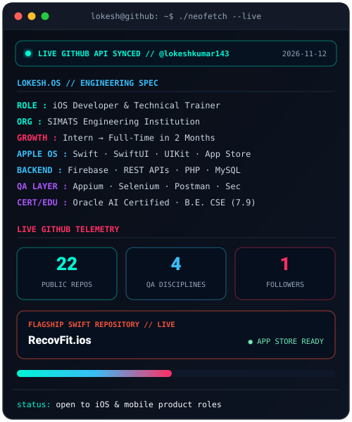
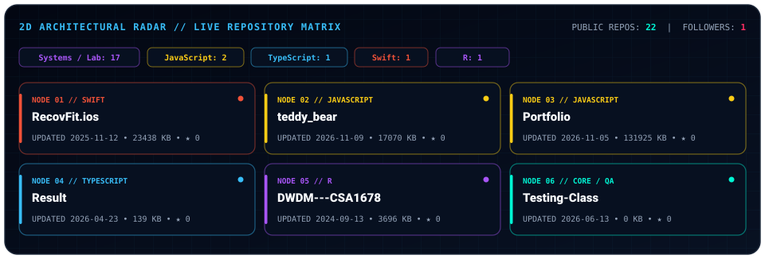
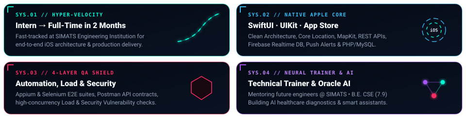
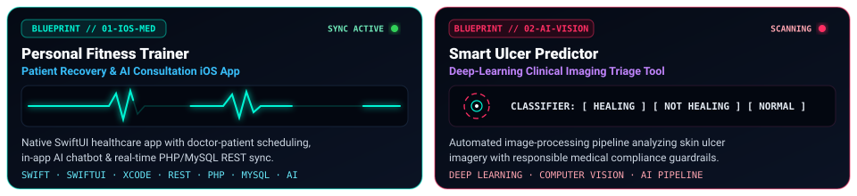
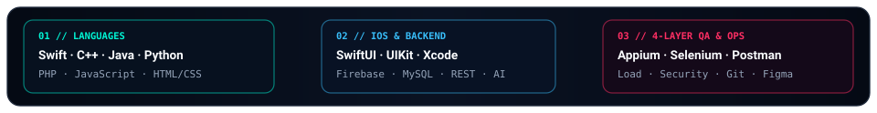
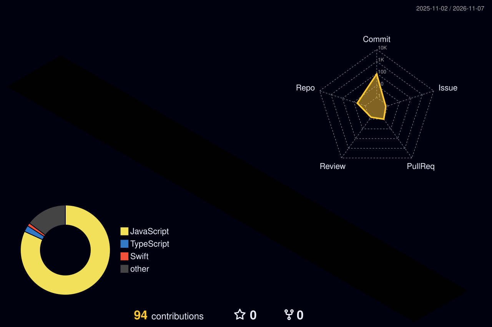
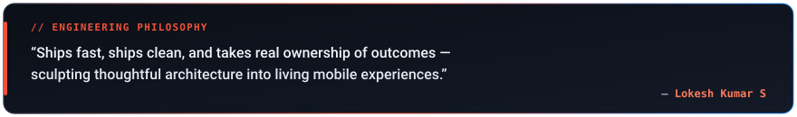
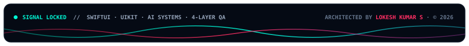

<h1 align="center">Lokesh Kumar S</h1>

  <b>Mobile Application Developer &middot; iOS (SwiftUI &amp; UIKit) &middot; Technical Trainer @ SIMATS</b>

<table width="100%">
<tr>
<td width="50%" valign="top">
  
</td>
<td width="50%" valign="top">
  
</td>
</tr>
</table>

  

  
  &nbsp;
  
  &nbsp;
  
  &nbsp;
  
  &nbsp;
  

---

<h2 align="center">🌌 LIVE 3D &amp; 2D GITHUB UNIVERSE (AUTO-SYNCED FROM LIVE API)</h2>

  Pulled automatically from <code>@lokeshkumar143</code>'s live GitHub repositories every 6 hours via GitHub Actions &bull; <a href="https://lokeshkumar143.github.io/lokeshkumar143/"><b>Open Interactive 3D / 2D Web Universe &rarr;</b></a>

  

  

---

<h2 align="center">⚡ NEURAL TELEMETRY &amp; CAREER CORE</h2>

  

<b>🛰️ Expand Mission Dossier — 30-Second Recruiter &amp; Engineering Brief</b>

 

- **Rapid Trajectory (`Intern → Full-Time in 2 Months`):** Promoted early at **SIMATS Engineering Institution** for owning the full mobile lifecycle end-to-end — from SwiftUI/UIKit architecture and RESTful API integration to **App Store production releases**.
- **Apple Ecosystem Mastery:** Native **Swift, SwiftUI, UIKit, Xcode, Core Location, MapKit**, and **Clean Architecture**.
- **AI &amp; Backend Fusion:** Connects native clients with **Firebase (Realtime DB &amp; Push Notifications)**, **PHP/MySQL**, **AI conversational chatbots**, and **deep-learning imaging pipelines**.
- **4-Layer QA Shield:** Validates reliability across **UI/Mobile Automation (Appium, Selenium)**, **API Verification (Postman)**, **Load Testing**, and **Security Vulnerability Testing**.
- **Leadership &amp; Credentials:** **Technical Trainer @ SIMATS** mentoring future engineers &bull; **B.E. Computer Science (7.9 CGPA)** &bull; **Oracle AI Certified**.

---

<h2 align="center">🛸 HOLOGRAPHIC PROJECT BLUEPRINTS</h2>

  

<table width="100%">
<tr>
<td width="50%" valign="top">
  <h3>🏥 Personal Fitness Trainer (Patient Recovery)</h3>
  
End-to-end native iOS recovery platform connecting patients and clinicians with appointment scheduling, real-time <b>PHP/MySQL</b> sync, and an <b>in-app AI conversational assistant</b>.

  

    
<b>Inspect Architecture Specs</b>

    <ul>
      <li><b>iOS Client:</b> Swift &amp; SwiftUI views built in Xcode with clean REST networking</li>
      <li><b>Sync Layer:</b> Real-time patient recovery &amp; doctor consultation records via PHP/MySQL</li>
      <li><b>AI Module:</b> Embedded conversational guidance for daily recovery tracking</li>
    </ul>
  

   
  
</td>
<td width="50%" valign="top">
  <h3>🩹 Smart Ulcer Predictor (Clinical AI Vision)</h3>
  
AI-powered diagnostic support system leveraging deep learning to classify skin ulcer imagery into <i>Healing</i>, <i>Not Healing</i>, or <i>Normal Skin</i> with compliance guardrails.

  

    
<b>Inspect Architecture Specs</b>

    <ul>
      <li><b>Vision Pipeline:</b> Automated image preprocessing, normalization, and fast inference</li>
      <li><b>3-Class Output:</b> Clear visual triage categories for healthcare decision support</li>
      <li><b>Safety Guardrails:</b> Built-in medical compliance disclaimers and edge-case validation</li>
    </ul>
  

   
  
</td>
</tr>
</table>

---

<h2 align="center">🧬 ANIMATED TECH CORE &amp; ARSENAL</h2>

  

  
    
  

---

<h2 align="center">🌌 3D CONTRIBUTION SKYLINE &amp; NEURAL SNAKE</h2>

  Live GitHub Actions telemetry &mdash; auto-rendered daily into interactive vector animations.

  

  

---

<h2 align="center">📡 LIVE SYSTEM METRICS</h2>

  
  

  

  

---

<h2 align="center">🔗 ESTABLISH CONNECTION</h2>

  Open for <b>iOS Engineer</b>, <b>Mobile App Developer</b>, and <b>AI-Enabled Product Engineering</b> roles. 
  Let's build the next generation of fast, resilient mobile experiences.

<table align="center">
<tr>
<td align="center" width="210">
  <a href="https://linkedin.com/in/lokesh-kumar-s-16984a268/">
    
      
    
  </a>
   
  <b>Professional Network</b>
</td>
<td align="center" width="210">
  <a href="https://github.com/lokeshkumar143?tab=repositories">
    
      
    
  </a>
   
  <b>Repositories &amp; Code</b>
</td>
<td align="center" width="210">
  <a href="mailto:lokeshkumar142005@gmail.com">
    
      
    
  </a>
   
  <b>lokeshkumar142005@gmail.com</b>
</td>
</tr>
</table>

  

