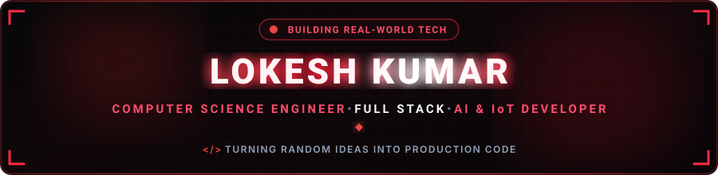
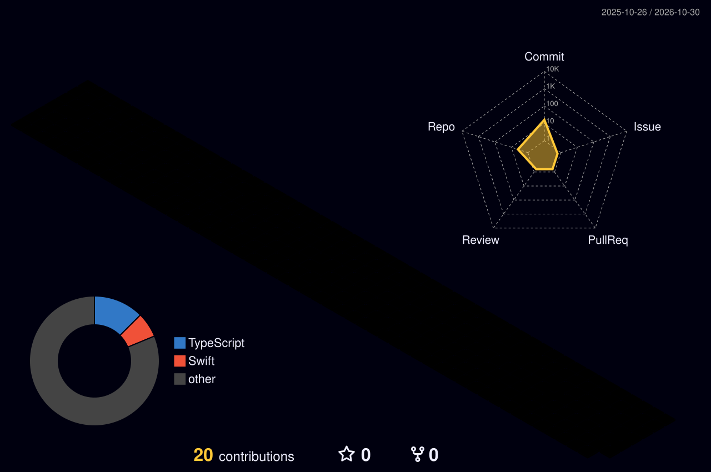
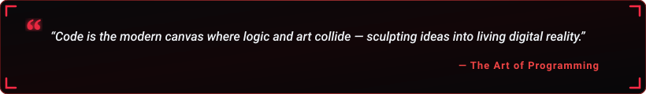

  

  

  
  &nbsp;
  
  &nbsp;
  
  &nbsp;
  

  
  &nbsp;
  

---

<h2 align="center">🔴 Professional Summary</h2>

  

  

  Hey! I'm <b>Lokesh Kumar S</b>, an <b>iOS Developer & Technical Trainer</b> based in India. 
  Promoted from <b>Intern → Full-Time Developer in just two months</b> at SIMATS Engineering Institution. I own the full mobile application lifecycle end-to-end: architecting native <b>SwiftUI & UIKit</b> interfaces, integrating RESTful APIs, and shipping polished production apps live to the App Store.

  
  &nbsp;
  
  &nbsp;
  

  💬 <b>Core Competencies:</b> Native iOS Engineering, Cross-Functional Mentorship, App Store Deployments, and QA across 4 Testing Disciplines. 
  ⚡ <b>Philosophy:</b> <i>"Ships fast, ships clean, and takes real ownership of outcomes."</i>

<table width="100%" border="0" align="center">
<tr>
<td width="50%" align="center" style="padding: 14px;">
  <h4>📱 Native iOS Engineering</h4>
  
<b>SwiftUI · UIKit · Xcode</b> Core Location · MapKit · Clean Architecture

</td>
<td width="50%" align="center" style="padding: 14px;">
  <h4>🔗 Backend &amp; Integration</h4>
  
<b>Firebase · REST APIs · PHP · MySQL</b> Realtime DB · Push Notifications · AI Chatbots

</td>
</tr>
<tr>
<td width="50%" align="center" style="padding: 14px;">
  <h4>🧪 Quality Assurance &amp; Testing</h4>
  
<b>Selenium · Appium · Postman</b> Load Testing · Security Vulnerability Testing

</td>
<td width="50%" align="center" style="padding: 14px;">
  <h4>👨‍🏫 Mentorship &amp; Education</h4>
  
<b>Technical Trainer @ SIMATS</b> B.E. CSE (CGPA 7.9) · Oracle AI Certified

</td>
</tr>
</table>

---

<h2 align="center">🔴 Featured Projects Spotlight</h2>

<table width="100%" border="0" align="center">
<tr>
<td width="50%" align="left" style="padding: 18px; vertical-align: top;">
  <h3>🏥 Personal Fitness Trainer for Patient Recovery</h3>
  
Developed a native healthcare iOS application utilizing <b>Swift, SwiftUI, and Xcode</b> for patient recovery and fitness management. Features appointment scheduling, doctor-patient consultation, REST API integration, and an in-app AI conversational assistant. Built with an intuitive UI and a <b>PHP/MySQL backend</b> for secure real-time health data synchronization.

   
  

    
  

</td>
<td width="50%" align="left" style="padding: 18px; vertical-align: top;">
  <h3>🩹 Smart Ulcer Predictor</h3>
  
Architected an AI-powered medical diagnostic support tool that leverages advanced deep learning models to analyze skin ulcer imagery and provide instant classifications (<i>Healing</i>, <i>Not Healing</i>, or <i>Normal Skin</i>). Implemented an automated image-processing pipeline with medical compliance disclaimers for responsible healthcare assistance.

   
  

    
  

</td>
</tr>
</table>

---

<h2 align="center">🏙️ 3D Contribution Skyline</h2>

<i>Automatically generated via GitHub Actions daily build workflow.</i>

  

---

<h2 align="center">🛠️ Technical Skills &amp; Stack</h2>

<b>Mobile &amp; Programming Languages</b>

  

<b>Frameworks, Mobile &amp; Backend</b>

  

<b>Developer Tools, Testing &amp; QA</b>

  

---

<h2 align="center">📊 GitHub Analytics &amp; Activity</h2>

  
  &nbsp;&nbsp;
  

  

  

---

<h2 align="center">⚡ Contribution Journey</h2>

<i>Interactive snake eating my contribution matrix (powered by GitHub Actions).</i>

  

---

<h2 align="center">📬 Let's Connect &amp; Collaborate</h2>

<i>Whether you want to discuss iOS architecture, Swift/SwiftUI apps, mobile testing, or tech mentorship — my inbox is always open!</i>

<table border="0" align="center">
<tr>
<td align="center" width="220" style="padding: 16px;">
  <a href="https://linkedin.com/in/lokesh-kumar-s-16984a268/" target="_blank">
    
      
    
  </a>
   
  <b>Professional Network</b>
</td>
<td align="center" width="220" style="padding: 16px;">
  <a href="https://github.com/lokeshkumar143" target="_blank">
    
      
    
  </a>
   
  <b>Open Source &amp; Projects</b>
</td>
<td align="center" width="220" style="padding: 16px;">
  <a href="mailto:lokeshkumar142005@gmail.com">
    
      
    
  </a>
   
  <b>Direct Collaboration</b>
</td>
</tr>
</table>

  

