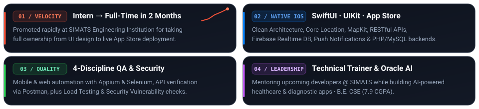

  

  
  &nbsp;
  
  &nbsp;
  
  &nbsp;
  
  &nbsp;
  

  
    <b>iOS Developer &amp; Technical Trainer @ SIMATS</b> &nbsp;&bull;&nbsp;
    <b>Intern &rarr; Full-Time in 2 Months</b> &nbsp;&bull;&nbsp;
    <b>App Store Shipper</b> &nbsp;&bull;&nbsp;
    <b>Oracle AI Certified</b>
  

---

<h2 align="center">Career Highlights &amp; Engineering DNA</h2>

  

<b>Recruiter Quick-Brief: Why teams hire &amp; promote me fast (30-second read)</b>

 

- **Rapid Ownership (`Intern → Full-Time in 2 Months`):** Promoted early at **SIMATS Engineering Institution** after owning the full mobile lifecycle — UI/UX implementation, API integration, QA verification, and live **App Store** releases.
- **Native iOS Craft:** Production experience across **Swift, SwiftUI, UIKit, Xcode, Core Location, MapKit**, and **Clean Architecture**.
- **Full-Stack &amp; AI Fluency:** Connects native iOS clients seamlessly to **Firebase (Realtime DB &amp; Push Notifications)**, **RESTful APIs**, **PHP/MySQL**, and **deep-learning / conversational AI** pipelines.
- **4-Discipline QA Mindset:** Doesn't just write features — validates apps across **Functional UI Automation (Appium, Selenium)**, **API Testing (Postman)**, **Load Testing**, and **Security Vulnerability Testing**.
- **Force Multiplier &amp; Mentor:** Serves as a **Technical Trainer @ SIMATS**, mentoring emerging developers while holding a **B.E. in Computer Science (7.9 CGPA)** and **Oracle AI Certification**.

---

<h2 align="center">Featured Engineering Case Studies</h2>

<table width="100%">
<tr>
<td width="50%" valign="top">
  <h3>🏥 Personal Fitness Trainer for Patient Recovery</h3>
  
<b>Role:</b> End-to-End iOS Engineer &bull; <b>Stack:</b> <code>Swift</code> <code>SwiftUI</code> <code>Xcode</code> <code>PHP</code> <code>MySQL</code> <code>REST</code> <code>AI</code>

  
Built a native healthcare recovery iOS application enabling patients and doctors to coordinate rehabilitation plans, appointments, and real-time progress tracking.

  <ul>
    <li><b>Client Architecture:</b> Native <b>SwiftUI</b> views backed by structured <b>REST API</b> networking</li>
    <li><b>Core Features:</b> Doctor-patient consultation flow, appointment scheduling, and an <b>in-app AI conversational assistant</b></li>
    <li><b>Backend Sync:</b> Custom <b>PHP &amp; MySQL</b> backend ensuring reliable health-data persistence</li>
  </ul>
  

    
<b>Inspect Technical Highlights</b>

    <ul>
      <li>Designed patient-friendly recovery workflows optimized for accessibility and daily check-ins.</li>
      <li>Implemented bidirectional sync between Xcode/SwiftUI client state and relational MySQL tables via authenticated REST endpoints.</li>
      <li>Embedded an AI assistant module to guide routine recovery queries between consultations.</li>
    </ul>
  

   
  
</td>
<td width="50%" valign="top">
  <h3>🩹 Smart Ulcer Predictor</h3>
  
<b>Role:</b> Mobile &amp; AI Systems Architect &bull; <b>Stack:</b> <code>Deep Learning</code> <code>Computer Vision</code> <code>Image Pipeline</code>

  
Architected an AI-powered diagnostic support system that analyzes skin ulcer imagery and classifies healing progression to assist clinical triage.

  <ul>
    <li><b>3-Class Inference:</b> Automated classification into <i>Healing</i>, <i>Not Healing</i>, or <i>Normal Skin</i></li>
    <li><b>Automated Pipeline:</b> Pre-processing, normalization, and fast inference workflow for mobile/clinical imagery</li>
    <li><b>Responsible AI:</b> Built-in medical compliance disclaimers and clear decision-support guardrails</li>
  </ul>
  

    
<b>Inspect Technical Highlights</b>

    <ul>
      <li>Standardized input image preprocessing to handle real-world lighting and framing variance before model inference.</li>
      <li>Structured classification outputs for immediate visual interpretability alongside non-diagnostic safety notices.</li>
      <li>Validated end-to-end latency and edge-case inputs to keep predictions reliable under field conditions.</li>
    </ul>
  

   
  
</td>
</tr>
</table>

---

<h2 align="center">Engineering Stack &amp; 4-Layer QA Matrix</h2>

<table width="100%">
<tr>
<td width="50%" valign="top">
  
<b>Apple &amp; Mobile Ecosystem</b>

  <ul>
    <li><b>UI &amp; Frameworks:</b> <code>Swift</code>, <code>SwiftUI</code>, <code>UIKit</code>, <code>Xcode</code></li>
    <li><b>Apple Services:</b> <code>Core Location</code>, <code>MapKit</code>, <code>Push Notifications</code></li>
    <li><b>Patterns:</b> <code>Clean Architecture</code>, App Store Release Pipeline</li>
  </ul>
  
<b>Backend, Cloud &amp; AI</b>

  <ul>
    <li><b>Cloud &amp; Data:</b> <code>Firebase Realtime DB</code>, <code>MySQL</code>, <code>PHP</code></li>
    <li><b>Integrations:</b> <code>RESTful APIs</code>, <code>AI Chatbots</code>, <code>Deep Learning Pipelines</code></li>
  </ul>
</td>
<td width="50%" valign="top">
  
<b>4-Layer Quality Assurance &amp; Security</b>

  <ul>
    <li><b>Mobile &amp; Web Automation:</b> <code>Appium</code>, <code>Selenium</code></li>
    <li><b>API &amp; Contract Verification:</b> <code>Postman</code></li>
    <li><b>Reliability &amp; Hardening:</b> <code>Load Testing</code>, <code>Security Vulnerability Testing</code></li>
  </ul>
  
<b>Core Languages &amp; Tooling</b>

  <ul>
    <li><b>Languages:</b> <code>Swift</code>, <code>C++</code>, <code>Java</code>, <code>Python</code>, <code>PHP</code>, <code>JavaScript</code>, <code>HTML/CSS</code></li>
    <li><b>Workflow:</b> <code>Git</code>, <code>GitHub Actions</code>, <code>Figma</code>, <code>Linux</code></li>
  </ul>
</td>
</tr>
</table>

  
    
  

---

<h2 align="center">3D Contribution Skyline &amp; Live Telemetry</h2>

  Auto-built daily by GitHub Actions &mdash; zero downtime, directly committed to this repository.

  

  
  

  

<b>Interactive Bonus: Watch the Contribution Snake Animation</b>

 

  

 

  

---

<h2 align="center">Let's Build Something Meaningful</h2>

  Open to <b>iOS Engineer</b>, <b>Mobile App Developer</b>, and <b>Product Engineering</b> opportunities. 
  If you're hiring or collaborating on Swift/SwiftUI apps, AI-enabled mobile products, or developer mentorship &mdash; let's talk.

<table align="center">
<tr>
<td align="center" width="210">
  <a href="https://linkedin.com/in/lokesh-kumar-s-16984a268/">
    
      
    
  </a>
   
  <b>Career &amp; Networking</b>
</td>
<td align="center" width="210">
  <a href="https://github.com/lokeshkumar143?tab=repositories">
    
      
    
  </a>
   
  <b>Code &amp; Open Source</b>
</td>
<td align="center" width="210">
  <a href="mailto:lokeshkumar142005@gmail.com">
    
      
    
  </a>
   
  <b>lokeshkumar142005@gmail.com</b>
</td>
</tr>
</table>

  

